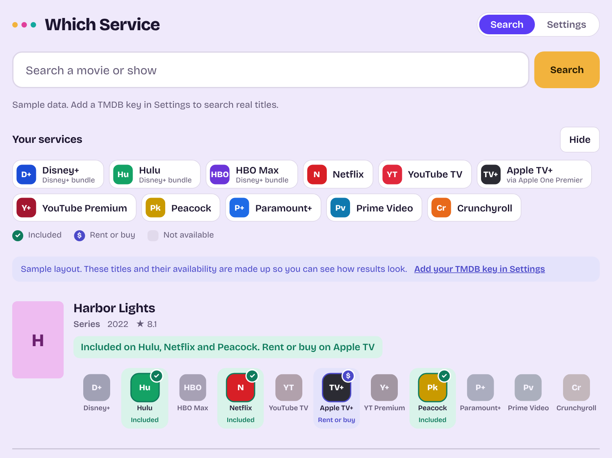

# Which Service

Search a movie or show and see which of **your** streaming services carry it.



*Sample data with invented titles. Service logos appear after you add a TMDB key.*

Which Service is a single web page. Search a title and each result shows the description, a row of twelve services, and the cast. Services that carry the title are **lit** with a ✓, a few get a **$** when you can only rent or buy the title there, and the rest are dimmed. Select a lit service to search for the title on that service, or select an actor to see their biography and filmography. No server, no build step, no dependencies.

## Services

Disney+, Hulu, HBO Max, Netflix, YouTube TV, YouTube Premium, Apple TV+, Peacock, Paramount+, Prime Video, Crunchyroll and Starz.

Prime Video and YouTube Premium light up only when the title is **included** with that subscription. Renting or buying on Amazon Video or YouTube does not light them. Apple TV+ also shows a **$** for titles you can rent or buy in the Apple TV store.

The list lives in the `SERVICES` array near the top of the `<script>` in `index.html`. Each entry matches TMDB's provider by id and by name, which also catches channel and premium variants (for example "Peacock Premium" or "Paramount Plus Apple TV Channel"). To change the list, edit `SERVICES`, plus the matching entry in `TILE` (the colour of the letter tile shown when a logo is missing).

## How it works

Availability comes from [TMDB](https://www.themoviedb.org/) watch-provider data, which is supplied by JustWatch. The app:

1. Searches TMDB (`/search/multi`) for movies and series.
2. Reads each result's description from the search results, and looks up each result's watch providers (`/{movie|tv}/{id}/watch/providers`) for your region.
3. Marks each of your services as included, rent or buy, or not available, and lists titles you can watch first.
4. Loads the top cast for each result (`/{movie|tv}/{id}/credits`) after the results appear, so a slow cast never delays availability.
5. Opens a person page on demand (`/person/{id}` and `/person/{id}/combined_credits`).
6. Fetches service logos from TMDB, and falls back to coloured letter tiles when a logo is not available.

**Links:** TMDB can say that a service carries a title, but it has no link to the title's own page inside the service. A lit service therefore opens **that service's search page for the title**, which is one tap from the title. Those addresses are in the `SEARCH` object in `index.html`. If a service changes its site, edit its line. "All watch options" opens TMDB's own watch page for the title.

**Limits:** this reads public availability data. It cannot see inside your accounts, so it does not know your personal libraries or purchases. Data can lag behind reality, and a service that TMDB does not list (YouTube TV may be one) will always show as not available.

## Setup

1. Make a free account at [themoviedb.org](https://www.themoviedb.org/signup).
2. In your TMDB account, open Settings, then API, and request a developer key.
3. Open `index.html` in Chrome (or any modern browser), or use the hosted page (see below).
4. Open the **Settings** tab, paste your **API Key** or **API Read Access Token**, and choose **Save and test key**.

Until a key is saved, the app shows invented sample titles so you can see the layout. Searching without a key sends you to Settings, and your search runs as soon as the key is saved.

If the browser blocks requests when you open the file directly, serve the folder instead:

```sh
python3 -m http.server
# then open http://localhost:8000
```

## Using it

- **Search tab:** type a title and press Enter. Each result has a description (select **More** for the full text), a row of the twelve services, and the top cast.
- **Services row:** lit services are links that open the service's search for the title. Dimmed services are not links.
- **Queue:** choose **Add to queue** on a result to save it to the end of your list. The Queue tab keeps your order (top is next), and you can move a title with **Top**, **Up** and **Down**. **Mark watched** moves it to a Watched section at the bottom, and **Mark unwatched** puts it back on top. Each time you open the tab it re-checks where every title streams. The queue is saved in this browser only and needs a TMDB key.
- **Cast:** select a name to open their person page: photo, basic facts (born, birthplace, known for), biography, and a filmography you can filter to movies or TV. Select a credit to search where it streams. The browser Back button returns to your results.
- **Services tab:** the twelve services with logos, and what the lit, $ and dimmed marks mean.
- **Sync:** in Settings, **Sign in with Google** keeps your queue the same on every device you sign in on, automatically. Only the queue is stored (in a free Firebase project, under your Google account), never your TMDB key. It works from the web address, not from a file opened on your computer.
- **Key box:** once a working key is saved, Settings shows only **Replace key**, **Remove key** and **Use sample data**. Choose **Replace key** to show the paste box again, or **Cancel** to hide it.
- **Settings tab:** the TMDB key, region, "Only show titles I can watch", .
- **Light and dark:** the page follows your system setting.

## Host it on GitHub Pages

1. In the repository, open **Settings → Pages**.
2. Set Source to **Deploy from a branch**, then choose branch `main` and folder `/ (root)`.
3. After a minute or two the page is live at `https://<your-user>.github.io/<repo-name>/`.

The hosted page is the same code for everyone: each visitor pastes their own TMDB key, which stays in their own browser. On a free GitHub account, Pages needs a public repository. Your key and settings on the hosted page are separate from the ones you saved when opening the file locally.

## Files

| File | What it is |
| --- | --- |
| `index.html` | The whole app: markup, styles and script. |
| `assets/favicon.svg` | The icon as an SVG (Chrome, Firefox and Edge tabs). |
| `assets/icon-32.png`, `assets/icon-192.png` | PNG tab icons. Safari needs these. |
| `assets/apple-touch-icon.png` | 180px icon used when the page is added to an iPhone or iPad home screen. |
| `docs/screenshot.png` | The screenshot above. |

## Keys and the build

The published site is built by GitHub Actions (`.github/workflows/pages.yml`, `scripts/build.mjs`). The build copies `index.html` and `assets/` into `dist/` and fills in two placeholders from repository secrets:

| Secret | Fills in | Needed |
| --- | --- | --- |
| `FIREBASE_API_KEY` | `__FIREBASE_API_KEY__` (Google sign-in and sync) | Yes, the build fails without it |
| `TMDB_KEY` | `__TMDB_KEY__` (the site works on every device with no pasting) | No. Without it each device pastes its own key in Settings |

**These keys are still visible in the published page.** A static site has to send them to the browser. Secrets keep them out of the repository's source and history, not out of view. To limit misuse, restrict the Firebase key to your site in Google Cloud (Credentials, your API key, Websites, `https://codecultivar.github.io/*`). TMDB keys are free and can be revoked. The Firestore rules are what protect your queue.

**Setup:** in the repo, add both secrets under Settings, Secrets and variables, Actions. Then set Settings, Pages, Source to **GitHub Actions**. Each push to `main` rebuilds and deploys.

**Local copy:** opening `index.html` straight from the repo has no keys filled in, so paste a TMDB key in Settings. Sync is off there. To test the build locally: `FIREBASE_API_KEY=... TMDB_KEY=... node scripts/build.mjs`, then open `dist/index.html`.

## Privacy and security

- Your TMDB key is stored in plain text in your browser's `localStorage` (key name `ws.key`). It leaves your browser only in requests to `api.themoviedb.org`.
- The repository contains no key. Never commit one.
- Anyone who can use your browser profile can read the key. When opened from `file://`, Chrome shares storage across local files, so serving from `localhost` or Pages gives the app its own storage. A TMDB key is free and read-only, and you can regenerate it in your TMDB account at any time.
- Saved in your browser (and, only if you sign in, your queue in Firebase): the key, region, the "only show titles I can watch" choice, your queue, and cached logo paths.

## Regions

United States, Canada, United Kingdom, Australia, Germany, France, Spain, Italy, Mexico, Brazil, Japan and India. Add more in the `REGIONS` object in `index.html`.

## Design

The page uses [Bricolage Grotesque](https://fonts.google.com/specimen/Bricolage+Grotesque) from Google Fonts. If the font cannot load, it falls back to your system font.

## Attribution

Streaming availability data from JustWatch, provided through TMDB. Service logos from TMDB.

This product uses the TMDB API but is not endorsed or certified by TMDB. Keep this notice in the app's footer.

Service names and logos belong to their respective owners.
